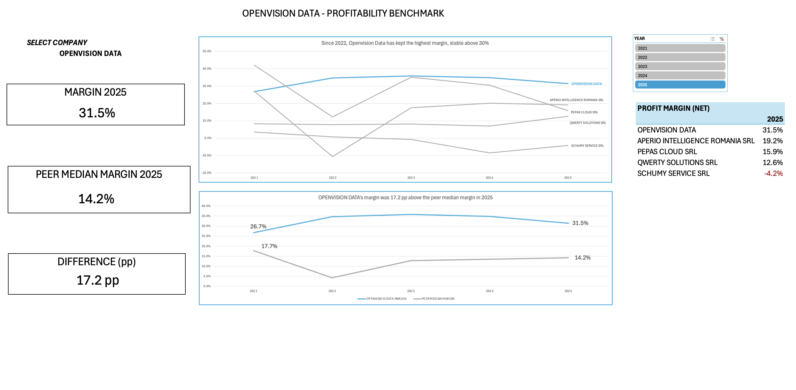

# Openvision Data – Profitability Benchmark & 2025 Margin Forecast

An Excel analysis of the net profit margin of **Openvision Data**, a Romanian IT services company (CAEN 6203), compared with four similar-sized peers, with a 2025 forecast tested against the real 2025 results.

## Business questions

1. How did Openvision's net profit margin compare with similar IT companies (same CAEN code, similar size) in 2021–2024?
2. How accurately can the 2025 net margin be forecast from the 2021–2024 trend?

## Data

- **Source:** Romanian Ministry of Finance (mfinante.gov.ro), public annual financial statements, 2021–2025, in RON.
- **Companies:** Openvision Data and four peers selected by the same CAEN code (6203), 2024 turnover between 50% and 200% of Openvision's, a comparable number of employees, and complete data for 2021–2025.
- **Data quality checks:** on every row, total assets equal total liabilities and equity, and total revenues minus total expenses equal the gross result.
- **Holdout:** the 2025 data was kept aside while building the forecast. The forecast was frozen first and the 2025 data was opened afterwards, so the test is unbiased.

## Key findings

1. Openvision's net margin was above the peer median in every year from 2021 to 2025. The gap widened from 9.0 pp in 2021 to 30.5 pp in 2022, mainly because the peer median fell from 17.7% to 4.3%, and has since narrowed to 17.2 pp in 2025.
2. Openvision has had the highest net margin in the peer group every year since 2022. Its margin peaked at 35.9% in 2023 and has declined since, with the drop accelerating in 2025 (−1.0 pp in 2024, −3.4 pp in 2025).
3. The 2025 decline was driven by costs growing faster than revenue (21.3% vs 16.4%), while headcount stayed unchanged. The peer median rose in the same year, which suggests the cause is mostly company-specific.
4. The forecast (35.3%) overestimated the actual 2025 margin (31.5%) by 3.9 pp. Excluding 2021 was justified, as the method that included it had the largest error (8.0 pp). All methods missed because a cost increase cannot be anticipated from past margin trends alone.
5. Openvision had the highest return on assets in the group every year (55–74%), while keeping a low debt ratio (11–37%), well below the most indebted peers. Its profitability comes from efficiency, not borrowed money.

## Forecast test

| Method | 2025 forecast | Actual | Error |
|---|---|---|---|
| Linear trend 2021–2024 (rejected) | 39.5% | 31.5% | −8.0 pp |
| **Linear trend 2022–2024 (chosen)** | **35.3%** | 31.5% | **−3.9 pp** |
| Average 2022–2024 | 35.2% | 31.5% | −3.7 pp |
| Naive (2025 = 2024) | 34.9% | 31.5% | −3.4 pp |

## Workbook structure

| Sheet | Content |
|---|---|
| FINDINGS | The five key conclusions |
| DASHBOARD | Interactive view: company selector, KPI cards, margin charts, pivot table with year slicer |
| FORECAST VS ACTUAL | Margin history, four forecasting methods, decision, comparison with 2025 actuals and evaluation |
| NOTES | Business questions, period, peer selection, data source and data anomalies |
| GLOSSARY | Definitions, formulas and interpretation of the six indicators |
| SUMMARY | Calculations behind the dashboard (company vs peer median) |
| INDICATORS | Six financial indicators for every company and year |
| RAW DATA | Original financial statement data (Excel Table) |

## Indicators

Net profit margin · Revenue growth · Return on assets (ROA) · Return on equity (ROE) · Debt ratio · Revenue per employee

## Excel skills used

- Excel Tables and structured references
- Dynamic array formulas: `FILTER`, `UNIQUE`, `SORT`, `TRANSPOSE`, spill ranges (`#`)
- `MEDIAN(FILTER(...))` for peer benchmarks, `SUMIFS` and `LET` for year-over-year growth
- Data validation dropdown linked to the whole workbook
- PivotTable with slicer, dynamic chart titles, conditional formatting
- `FORECAST.LINEAR` and comparison of forecasting methods

## Limitations

- The forecast rests on only three data points (2022–2024).
- Public statements do not break expenses down, so the exact cause of the 2025 cost increase cannot be confirmed.
- The peer group is small (four companies).
- External factors (contracts, salaries, market conditions) were not modelled.

## How to use

Download `Openvision_Profitability_Analysis.xlsx` and open it in Excel for Microsoft 365 (dynamic array formulas are required). On the DASHBOARD sheet, choose a company from the dropdown and a year in the slicer.

## Author

Chivu Andrei Ciprian – Bachelor's degree in Business Administration (FABIZ, ASE Bucharest)

[LinkedIn](https://www.linkedin.com/in/ciprian-andrei-chivu/)
